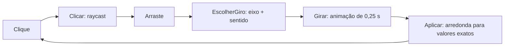

# Piramix — documentação detalhada

Uma Pyraminx (pirâmide tipo cubo mágico, 3 andares) jogável, feita em Unity (URP, Input System). Este documento explica **cada parte do projeto**, com o código e a teoria de computação gráfica / álgebra linear por trás.

## Sumário

1. [Visão geral](#1-visão-geral)
2. [Estrutura do repositório](#2-estrutura-do-repositório)
3. [Fundamentos matemáticos](#3-fundamentos-matemáticos)
4. [Geometria: tetraedro, cubo e eixos](#4-geometria-tetraedro-cubo-e-eixos)
5. [Malhas (meshes)](#5-malhas-meshes)
6. [A cena: hierarquia e posição das peças](#6-a-cena-hierarquia-e-posição-das-peças)
7. [`Piramix.cs` — a lógica do jogo](#7-piramixcs--a-lógica-do-jogo)
8. [`CameraOrbita.cs` — a câmera](#8-cameraorbitacs--a-câmera)
9. [Scripts de apoio](#9-scripts-de-apoio)
10. [Materiais](#10-materiais)
11. [Como foi validado](#11-como-foi-validado)
12. [Controles](#12-controles)
13. [Perguntas que podem aparecer](#13-perguntas-que-podem-aparecer)

---

## 1. Visão geral

A Pyraminx é um tetraedro de lado 3 dividido em **15 peças**:

| Tipo de peça | Quantidade | Forma |
|---|---|---|
| Tetraedros "em pé" | 10 | tetraedro regular de aresta 1 |
| Octaedros | 4 | octaedro regular de aresta 1 |
| Tetraedro invertido | 1 | tetraedro regular, no centro (interno) |

O jogador:

- **gira uma camada** clicando numa peça e arrastando o mouse;
- **gira a câmera** em torno da pirâmide com Alt + arrastar;
- **dá zoom** com a roda do mouse.

Cada giro é de **120°** em torno de um dos **4 eixos** que passam por um vértice e pelo centro da pirâmide.

O fluxo do jogo:



---

## 2. Estrutura do repositório

```
Assets/
├── Scenes/SampleScene.unity     cena: Piramix + peças + câmera + luz
├── Scripts/
│   ├── Piramix.cs               lógica de giro, clique e arraste
│   ├── CameraOrbita.cs          câmera orbital + zoom
│   ├── TetraedroRegular.cs      gera a malha de um tetraedro regular
│   ├── ArestasTetraedro.cs      desenha as 6 arestas com LineRenderer
│   └── Editor/TetraedroMenu.cs  menu do editor para criar um tetraedro
├── Octaedro.asset               malha do octaedro (aresta 1)
├── Adesivo.asset                malha do adesivo (prisma triangular fino)
├── Tetraedro.asset              malha do tetraedro (aresta 1)
├── Materials/                   Preto, Branco, Vermelho, Verde, Azul, Amarelo
└── ...
```

---

## 3. Fundamentos matemáticos

Esta seção reúne os conceitos usados no resto do documento.

### 3.1 Vetor e posição

Um `Vector3` é uma seta. Usada como **posição**, é a seta da origem `(0,0,0)` até o ponto. No projeto a origem do espaço local da Piramix é o **centro da pirâmide**, então a posição de uma peça (`localPosition`) é a seta do centro até a peça.

### 3.2 Produto escalar

$$a \cdot b = a_x b_x + a_y b_y + a_z b_z = |a|\,|b|\cos\theta$$

A primeira forma é a conta que o computador faz. A segunda é o significado geométrico (θ é o ângulo entre os vetores).

Se $|\hat e| = 1$ (vetor **unitário**), então

$$d = p \cdot \hat e = |p|\cos\theta$$

é o comprimento da **projeção** de `p` sobre a reta de ê, com sinal. Em palavras: a "altura" de `p` medida ao longo de ê.

```
              ê
              ↑
              |      ● p
              |    ╱ |
              |  ╱   |
              |╱_____|
            origem   d = p·ê  (comprimento deste lado)
```

Os pontos com `p · ê = c` (c constante) formam um **plano perpendicular a ê**. Todos têm a mesma altura.

### 3.3 Normalizar

`v.normalized = v / |v|` mantém a direção e deixa o comprimento em 1. É necessário para que `p · ê` seja mesmo a distância e não a distância multiplicada por `|ê|`.

### 3.4 Rotação em torno de um eixo

Girar um vetor `v` de um ângulo θ em torno do eixo unitário `ê` (que passa pela origem) é dado pela **fórmula de Rodrigues**:

$$v' = v\cos\theta + (\hat e \times v)\sin\theta + \hat e\,(\hat e \cdot v)(1-\cos\theta)$$

A componente de `v` ao longo de ê (`ê · v`) **não muda**. Só a parte perpendicular gira. Por isso uma peça que gira em torno de um eixo mantém a mesma altura `d` em relação a ele.

### 3.5 Quatérnio

Um quatérnio guarda uma rotação em 3D com 4 números $(x, y, z, w)$. Para girar θ em torno de ê:

$$q = \big(\cos\tfrac{\theta}{2},\ \sin\tfrac{\theta}{2}\,\hat e\big)$$

No Unity: `Quaternion.AngleAxis(theta, e)`.

- **Aplicar a um vetor:** `q * v` dá o vetor girado (equivale a $q\,v\,q^{-1}$, que é a fórmula de Rodrigues).
- **Compor rotações:** `q2 * q1` aplica `q1` primeiro e depois `q2`. A ordem importa (rotações 3D não comutam).
- **Inverso:** `q⁻¹` é a rotação oposta. O sinal do ângulo faz o mesmo papel.
- **Vantagens sobre ângulos de Euler:** não sofre *gimbal lock*, é fácil de compor e de interpolar.

| Código | Significado |
|---|---|
| `Quaternion.AngleAxis(120f, eixo)` | rotação de 120° em torno de `eixo` |
| `q * pos` | `pos` girada por `q` |
| `q * rot` | orientação `rot` seguida do giro `q` |
| `Quaternion.LookRotation(frente, cima)` | rotação cujo Z aponta para `frente` e cujo Y aponta para `cima` |

### 3.6 Espaço local e espaço de mundo

Cada `Transform` tem posição e rotação **relativas ao pai** (`localPosition`, `localRotation`). A matriz do pai leva do espaço local ao de mundo:

$$\text{mundo} = M_{pai} \cdot \text{local}$$

No Unity: `transform.TransformPoint(p)` (local → mundo) e `transform.InverseTransformPoint(p)` (mundo → local). Como as peças e os adesivos são filhos, quando o pai (ou uma peça) gira, os filhos acompanham sem código extra.

---

## 4. Geometria: tetraedro, cubo e eixos

### 4.1 Um tetraedro regular dentro de um cubo

Um tetraedro regular é formado por **4 vértices alternados de um cubo**. Num cubo com vértices em $(\pm1,\pm1,\pm1)$, tome os 4 que têm um número par de sinais negativos:

```
( 1,  1,  1)
( 1, -1, -1)
(-1,  1, -1)
(-1, -1,  1)
```

A distância entre dois quaisquer deles é a diagonal de uma face, $\sqrt{0+4+4} = 2\sqrt2$. Como as 6 arestas são iguais, o tetraedro é regular.

Para a aresta valer 1, multiplica-se por

$$S = \frac{1}{2\sqrt2} \approx 0{,}3536$$

Os vértices ficam em $S\cdot(\pm1,\pm1,\pm1)$ e o comprimento de cada vértice (raio circunscrito) é $S\sqrt3 \approx 0{,}612$.

### 4.2 Os 4 eixos de rotação

Cada eixo vai do centro a um vértice. Em `Piramix.cs`:

```csharp
// eixos = direcoes dos vertices da piramide (referencial local da Piramix)
static readonly Vector3[] Eixos =
{
    new Vector3( 1,  1,  1).normalized,
    new Vector3( 1, -1, -1).normalized,
    new Vector3(-1,  1, -1).normalized,
    new Vector3(-1, -1,  1).normalized
};
static readonly float S = 1f / (2f * Mathf.Sqrt(2f));
```

`.normalized` divide por $\sqrt3$ e deixa cada eixo com comprimento 1.

O ângulo entre dois vértices vistos do centro tem cosseno $-1/3$ (≈ 109,5°). Isso é usado nos números da seção 7.2.

### 4.3 Por que 120°

Cada eixo passa por um vértice e pelo centro da face oposta. A pirâmide é invariante a giros de 120° em torno dele (simetria de ordem 3). Depois de 120° o sólido ocupa o mesmo lugar, só com as peças trocadas.

### 4.4 Consequência: as posições e rotações ficam numa grade

- **Posições:** toda coordenada de toda peça é um múltiplo inteiro de `S`.
- **Rotações:** as simetrias do tetraedro são um subgrupo das do cubo, então toda orientação válida é uma **matriz de permutação com sinal** (só entradas 0, +1, −1). Exemplo: o giro de 120° em torno de $(1,1,1)$ leva $x\to y\to z\to x$:

$$\begin{pmatrix}0&0&1\\1&0&0\\0&1&0\end{pmatrix}$$

Isso é a base da correção numérica em `Aplicar` (seção 7.8).

---

## 5. Malhas (meshes)

### 5.1 Tetraedro regular (`TetraedroRegular.cs`)

```csharp
public static Mesh Criar(float aresta)
{
    float s = aresta / (2f * Mathf.Sqrt(2f));
    var verts = new[]
    {
        s * new Vector3( 1,  1,  1),
        s * new Vector3( 1, -1, -1),
        s * new Vector3(-1,  1, -1),
        s * new Vector3(-1, -1,  1)
    };
    var tris = new[]
    {
        0, 1, 2,
        0, 2, 3,
        0, 3, 1,
        1, 3, 2
    };
    var mesh = new Mesh { name = "TetraedroRegular" };
    mesh.vertices = verts;
    mesh.triangles = tris;
    mesh.RecalculateNormals();
    mesh.RecalculateBounds();
    return mesh;
}
```

- 4 vértices (os da seção 4.1) e 4 faces triangulares, cada uma dada por 3 índices.
- `RecalculateNormals` calcula a normal de cada vértice a partir dos triângulos.
- O componente cria a malha em `Awake` se o `MeshFilter` ainda não tiver uma.

### 5.2 Ordem dos vértices (*winding*) e back-face culling

A GPU descarta (*cull*) as faces voltadas para longe da câmera. No Unity, a face **visível** é aquela cujos vértices aparecem em **sentido horário** para quem olha de fora. A normal geométrica é o produto vetorial

$$n = (b - a) \times (c - a)$$

Exemplo com o triângulo `0, 1, 2` (vértices $a=(1,1,1)$, $b=(1,-1,-1)$, $c=(-1,1,-1)$, ignorando `S`):

$$(b-a)\times(c-a) = (0,-2,-2)\times(-2,0,-2) = (4,4,-4)$$

Essa face fica oposta ao vértice 3, $(-1,-1,1)$, então a normal para fora é $-(−1,−1,1) = (1,1,−1)$. O resultado $(4,4,-4)$ aponta para o mesmo lado. A ordem está correta.

> **Correção feita no projeto:** `Tetraedro.asset` e `TetraedroRegular.cs` estavam com a ordem dos vértices invertida. As normais apontavam para dentro e, por causa do culling, o tetraedro aparecia "do avesso". A ordem dos triângulos foi invertida nos dois.

### 5.3 Octaedro (`Octaedro.asset`)

- Aresta 1, vértices em $\pm a$ sobre os eixos, com $a = 1/\sqrt2$ (a aresta é $a\sqrt2 = 1$).
- 8 faces triangulares × 3 vértices = **24 vértices**. Os vértices não são compartilhados entre faces para que cada face tenha a **própria normal** (sombreamento plano, aparência facetada).

### 5.4 Adesivo (`Adesivo.asset`)

- Prisma triangular fino: lado 0,9 e altura 0,02.
- 18 vértices: 2 triângulos (topo e base) + 3 retângulos laterais.
- Tem 90% do tamanho da face, por isso sobra uma **borda preta** ao redor.

### 5.5 Colisor

Cada peça precisa de um colisor para o raycast do clique. No `Awake`, `Piramix` adiciona um `MeshCollider` a cada peça que não tem collider:

```csharp
void Awake()
{
    foreach (Transform peca in transform)
    {
        pecas.Add(peca);
        if (peca.GetComponent<Collider>() == null)
            peca.gameObject.AddComponent<MeshCollider>().sharedMesh = peca.GetComponent<MeshFilter>().sharedMesh;
    }
}
```

`foreach (Transform peca in transform)` percorre os **filhos diretos** do objeto, que são as 15 peças (os adesivos são netos).

---

## 6. A cena: hierarquia e posição das peças

### 6.1 Grafo de cena

```
Piramix                  ← pai: girado para a ponta ficar em +Y, base em y=0
├── Tetraedro 1..10      ← peças "em pé"
├── Octaedro 1..4        ← preenchem os vãos
├── Tetraedro Invertido  ← centro (interno, fecha o sólido)
│    └── Adesivo <Cor>   ← adesivos são filhos das peças
```

- O objeto **Piramix** tem uma única rotação que leva a direção $(-1, 1, -1)$ para $+Y$. Assim a pirâmide fica "em pé" na tela (ponta para cima), e as peças trabalham em coordenadas locais simples. Vale `mundo = M_pai · local`.
- Os **adesivos são filhos das peças**. Por isso giram junto com elas sem nenhum código extra. Quem faz isso é a composição de transformações do grafo de cena.

### 6.2 Onde cada peça fica

Seja $V_m$ o vértice $m$ de um tetraedro de aresta 1, isto é, $V_m = S\cdot(\pm1,\pm1,\pm1)$:

| Peça | Posição | Quantidade |
|---|---|---|
| Tetraedros em pé | $V_a + V_b$, todos os pares com repetição ($a \le b$) | 10 (4 pontas com $a=b$ e 6 de aresta) |
| Octaedros | $V_m$ | 4 |
| Tetraedro invertido | origem; girado 90° em Z, o que leva $V$ em $-V$ | 1 |

### 6.3 Conferência de volume

Um tetraedro de lado 3 tem volume $3^3 = 27$ vezes o de lado 1. Um octaedro de aresta 1 vale **4** tetraedros de aresta 1. Então:

$$10\cdot 1 + 4\cdot 4 + 1 = 27$$

Os 27 "tetraedros unitários" do sólido são preenchidos sem buracos.

---

## 7. `Piramix.cs` — a lógica do jogo

O script fica no objeto **Piramix** (pai das 15 peças). Estado principal:

```csharp
[SerializeField] float duracao = 0.25f;         // duração do giro (s)
[SerializeField] float limiarArraste = 12f;     // arraste mínimo (px) para decidir o giro

readonly List<Transform> pecas = new List<Transform>();
bool girando;                                   // bloqueia entrada durante a animação

// estado do arraste
Transform pecaClicada;
Vector3 pontoClicado;
Vector2 inicioArraste;
int faceClicada = -1;
```

### 7.1 Visão do ciclo de entrada: `Update`

```csharp
void Update()
{
    // Pointer cobre mouse, touchpad, caneta e toque
    var ponteiro = Pointer.current;
    if (ponteiro == null || girando) return;

    // com Alt o arraste gira a camera (CameraOrbita), nao a camada
    if (CameraOrbita.AltPressionado)
    {
        pecaClicada = null;
        return;
    }

    if (ponteiro.press.wasPressedThisFrame)
        Clicar(ponteiro.position.ReadValue());
    else if (ponteiro.press.isPressed && pecaClicada != null)
    {
        Vector2 arraste = ponteiro.position.ReadValue() - inicioArraste;
        if (arraste.magnitude >= limiarArraste)
        {
            EscolherGiro(arraste);
            pecaClicada = null;
        }
    }
    else if (ponteiro.press.wasReleasedThisFrame)
        pecaClicada = null;
}
```

É uma pequena máquina de estados:

1. No frame em que o botão é pressionado: `Clicar` faz o raycast e guarda a peça.
2. Enquanto o botão está pressionado e há `pecaClicada`: mede o arraste. Quando passa de `limiarArraste` (12 px), chama `EscolherGiro` e solta a peça.
3. Ao soltar o botão, a seleção é descartada.

`girando` impede uma nova jogada durante a animação. `Alt` é reservado para a câmera.

### 7.2 Camada de cada peça: `CamadaDe`

```csharp
// 0 = ponta, 1 = meio, 2 = base
static int CamadaDe(Vector3 posLocal, int eixo)
{
    float d = Vector3.Dot(posLocal, Eixos[eixo]);
    if (d > 0.9f) return 0;
    if (d > 0.3f) return 1;
    return 2;
}
```

| Nome | Papel |
|---|---|
| `Eixos[eixo]` | $\hat e$: direção do centro até um vértice, comprimento 1 |
| `posLocal` | $p$: posição da peça medida a partir do centro |
| `d` | $p \cdot \hat e$: "altura" da peça ao longo do eixo, medida do centro |

`d` é a projeção de `posLocal` sobre o eixo. Os pontos com o mesmo `d` formam um plano perpendicular ao eixo, então comparar `d` com limites **fatia a pirâmide em camadas paralelas**:

```
         ê
         ↑
   ──────●────── ponta   d > 0,9
   ┄┄┄┄┄┄┄┄┄┄┄┄ plano d = 0,9
   ──────────── meio     0,3 < d ≤ 0,9
   ┄┄┄┄┄┄┄┄┄┄┄┄ plano d = 0,3
   ──────────── base     d ≤ 0,3
```

**Valores reais de `d`** para o eixo `a`, usando $|V| \approx 0{,}612$ e $V_b \cdot \hat e_a = |V|\cos\theta = 0{,}612\cdot(-\tfrac13) \approx -0{,}204$ (para $b \ne a$):

| Peça | Posição | `d` | Camada |
|---|---|---|---|
| tetraedro da ponta | $2V_a$ | ≈ 1,22 | ponta (1 peça) |
| octaedro | $V_a$ | ≈ 0,61 | meio |
| 3 tetraedros | $V_a + V_b$ ($b\ne a$) | ≈ 0,41 | meio |
| 3 octaedros | $V_b$ | ≈ −0,20 | base |
| 6 tetraedros | $V_b + V_c$ ($b,c \ne a$) | ≈ −0,41 | base |
| tetraedro invertido | origem | 0 | base |

No meio ficam 1 + 3 = **4** peças e na base 3 + 6 + 1 = **10**. Os limites 0,9 e 0,3 caem nos vãos entre esses grupos, então há bastante folga.

**Continua correta depois dos giros:** `CamadaDe` usa a posição **atual** (`localPosition`), não uma lista fixa. Como uma rotação em torno do eixo não muda `d` (seção 3.4) e leva cada peça a outra posição válida, a classificação segue certa depois de qualquer sequência de giros.

### 7.3 Descobrir onde o usuário clicou: `Clicar`

```csharp
void Clicar(Vector2 posTela)
{
    pecaClicada = null;
    var cam = Camera.main;
    Physics.SyncTransforms();
    if (cam == null || !Physics.Raycast(cam.ScreenPointToRay(posTela), out var hit)) return;

    Transform t = hit.transform;
    while (t != null && t.parent != transform) t = t.parent;
    if (t == null) return;

    Vector3 normal = transform.InverseTransformDirection(hit.normal);
    faceClicada = -1;
    for (int m = 0; m < 4; m++)
        if (Vector3.Dot(normal, -Eixos[m]) > 0.99f) faceClicada = m;
    if (faceClicada < 0) return;

    pecaClicada = t;
    pontoClicado = transform.InverseTransformPoint(hit.point);
    inicioArraste = posTela;
}
```

**Picking com raio.** `cam.ScreenPointToRay(posTela)` cria um raio que sai da câmera e passa pelo pixel clicado (a inversa da projeção em perspectiva). `Physics.Raycast` intersecta esse raio com os `MeshCollider`s e devolve o ponto (`hit.point`) e a normal (`hit.normal`) da face atingida, ambos em coordenadas de **mundo**.

**Achar a peça.** O objeto atingido pode ser um adesivo (neto). O laço `while` sobe na hierarquia até chegar ao filho direto da Piramix, que é a peça.

**Descobrir a face grande.** A normal é levada para o espaço local (`InverseTransformDirection`). A face da pirâmide oposta ao vértice `m` tem normal $-\hat e_m$. O código compara a normal clicada com cada um dos 4 valores por produto escalar. Se $n \cdot (-\hat e_m) > 0{,}99$ (ângulo menor que ~8°), a face é a `m`. Se nenhuma bate (clique na lateral de um adesivo, por exemplo), o clique é ignorado.

`pontoClicado` fica guardado em coordenadas **locais** para ser usado em `EscolherGiro`.

`Physics.SyncTransforms()` garante que os colisores estão com as posições atualizadas depois de um giro.

### 7.4 Escolher o giro pelo arraste: `EscolherGiro`

Dado o arraste na tela, o código precisa descobrir **qual eixo e qual sentido** o usuário quis.

```csharp
void EscolherGiro(Vector2 arraste)
{
    var cam = Camera.main;
    Vector2 dir = arraste.normalized;
    Vector2 telaPonto = cam.WorldToScreenPoint(transform.TransformPoint(pontoClicado));
    float melhor = float.NegativeInfinity;
    int eixo = -1, sentido = 0;

    for (int m = 0; m < 4; m++)
    {
        if (m == faceClicada) continue;
        foreach (int sg in new[] { 1, -1 })
        {
            Vector3 girado = Quaternion.AngleAxis(sg * 5f, Eixos[m]) * pontoClicado;
            Vector2 tela = cam.WorldToScreenPoint(transform.TransformPoint(girado));
            Vector2 mov = tela - telaPonto;
            if (mov.sqrMagnitude < 1e-6f) continue;
            float score = Vector2.Dot(mov.normalized, dir);
            if (score > melhor) { melhor = score; eixo = m; sentido = sg; }
        }
    }
    if (eixo < 0) return;
    StartCoroutine(Girar(eixo, CamadaDe(pecaClicada.localPosition, eixo), sentido, duracao));
}
```

Ideia: para cada candidato, **simular um giro pequeno** e ver para onde o ponto clicado andaria na tela.

1. Para cada eixo `m` e cada sentido `sg` (±1), gira `pontoClicado` em 5° em torno de `Eixos[m]`.
2. **Projeta** o ponto antes e depois na tela com `WorldToScreenPoint` (que aplica model → view → projeção → viewport). A diferença `mov` é o deslocamento do ponto em pixels.
3. Compara `mov.normalized` com a direção do arraste `dir` por produto escalar (`score = cos` do ângulo entre eles).
4. Vence o candidato com **maior score**, isto é, aquele cujo movimento na tela mais se parece com o arraste.

O eixo `faceClicada` é ignorado (`if (m == faceClicada) continue`). Ele é o eixo perpendicular à face clicada, e girar em torno dele moveria o ponto **dentro** do plano da face. Esse não é um giro de camada válido, e sobram 3 eixos × 2 sentidos = **6 candidatos**.

Por fim `Girar` recebe o eixo, a camada da peça clicada naquele eixo (`CamadaDe`) e o sentido.

### 7.5 O giro: `Girar`

```csharp
IEnumerator Girar(int eixo, int camada, int sentido, float tempo)
{
    girando = true;
    var camadaPecas = new List<(Transform t, Vector3 pos, Quaternion rot)>();
    foreach (var p in pecas)
        if (CamadaDe(p.localPosition, eixo) == camada)
            camadaPecas.Add((p, p.localPosition, p.localRotation));

    float angulo = 120f * sentido;
    for (float t = 0; t < tempo; t += Time.deltaTime)
    {
        var q = Quaternion.AngleAxis(angulo * Mathf.SmoothStep(0, 1, t / tempo), Eixos[eixo]);
        foreach (var (p, pos, rot) in camadaPecas)
        {
            p.localPosition = q * pos;
            p.localRotation = q * rot;
        }
        yield return null;
    }
    foreach (var (p, pos, rot) in camadaPecas)
        Aplicar(p, Quaternion.AngleAxis(angulo, Eixos[eixo]), pos, rot);
    girando = false;
}
```

| Parâmetro | Significado |
|---|---|
| `eixo` | índice 0 a 3, escolhe $\hat e$ = `Eixos[eixo]` |
| `camada` | 0 ponta, 1 meio, 2 base |
| `sentido` | +1 ou −1 (sinal do ângulo) |
| `tempo` | duração (0,25 s) |

**Passo 1 — congelar as peças da camada.** `CamadaDe(...) == camada` seleciona as peças. Para cada uma guarda a **pose inicial** `(pos, rot)`. A lista é montada **uma vez**, antes da animação.

**Passo 2 — a posição e a orientação giram juntas.**

```csharp
p.localPosition = q * pos;   // p' = q · p   (a peça muda de lugar)
p.localRotation = q * rot;   // r' = q · r   (a peça também vira)
```

Se só a posição girasse, a peça "deslizaria" até o novo lugar mantendo a mesma direção (os adesivos ficariam virados para o lado errado). Multiplicar a orientação por `q` faz a peça girar como um corpo rígido. Como o eixo passa pela **origem** do espaço local, não é preciso transladar para a origem antes de girar e voltar depois.

**Passo 3 — a animação (item 7.6).**

**Passo 4 — fechar o giro.** Depois do laço, chama `Aplicar` com o giro **completo** de 120°, que posiciona a peça no valor exato e corrige o erro numérico (item 7.8). Só então `girando = false`.

### 7.6 Animação: tempo, SmoothStep e pose inicial

O laço roda uma vez por frame (`yield return null` espera o próximo). A cada volta:

- `t / tempo` vai de 0 a 1 e é a fração do tempo concluída ($x$);
- `Mathf.SmoothStep(0, 1, x)` $= 3x^2 - 2x^3$ transforma essa fração numa fração do ângulo, com início e fim suaves;
- o ângulo da vez é `angulo * SmoothStep(...)`.

```
ângulo
120° │                 ╭───
     │               ╭╯
     │            ╭──╯        inclinação máxima no meio
     │         ╭──╯
     │      ╭─╯
  0° │──────╯                  velocidade ≈ 0 no começo e no fim
     └──────────────────▶ t
     0                  0,25 s
```

| $x$ | SmoothStep | ângulo |
|---|---|---|
| 0 | 0 | 0° |
| 0,25 | 0,156 | 18,8° |
| 0,5 | 0,5 | 60° |
| 0,75 | 0,844 | 101,3° |
| 1 | 1 | 120° |

A derivada $6x - 6x^2$ é zero em $x=0$ e $x=1$, por isso a camada acelera e desacelera suavemente em vez de arrancar e parar de repente.

**Por que recalcular a partir da pose inicial.** A alternativa seria girar a peça um pouco a cada frame, partindo de onde ela está:

```csharp
// incremental (NÃO é o que o código faz)
p.localPosition = Quaternion.AngleAxis(delta, e) * p.localPosition;
```

Nesse caso cada frame depende do anterior e o erro de ponto flutuante (≈10⁻⁷ por conta) se acumula. O código usa a forma **absoluta**:

```
pos (fixa) ──q(t₁)──► pose no frame 1
pos (fixa) ──q(t₂)──► pose no frame 2
pos (fixa) ──q(t₃)──► pose no frame 3
```

Todo frame parte da mesma pose inicial. O erro de um frame não passa para o seguinte.

O último frame do laço quase nunca cai em exatamente 120° (por exemplo, para em 117°). Por isso existe o passo final com `Aplicar`.

### 7.7 Por que `Aplicar` é necessário

Mesmo calculando bem, cada `q * pos` usa seno e cosseno em `float` e deixa um erro minúsculo. Depois de centenas de jogadas, as peças sairiam um pouco do lugar, apareceriam vãos, e o corte de `CamadaDe` poderia classificar uma peça errada. `Aplicar` zera o erro a cada giro, explorando duas propriedades da seção 4.4.

### 7.8 Correção numérica: `Aplicar`

```csharp
static void Aplicar(Transform p, Quaternion q, Vector3 pos, Quaternion rot)
{
    Vector3 nova = q * pos / S;
    p.localPosition = new Vector3(Mathf.Round(nova.x), Mathf.Round(nova.y), Mathf.Round(nova.z)) * S;

    Quaternion r = q * rot;
    Vector3 frente = Arredondar(r * Vector3.forward);
    Vector3 cima = Arredondar(r * Vector3.up);
    p.localRotation = Quaternion.LookRotation(frente, cima);
}

static Vector3 Arredondar(Vector3 v) => new Vector3(Mathf.Round(v.x), Mathf.Round(v.y), Mathf.Round(v.z));
```

| Variável | Significado |
|---|---|
| `p` | a peça |
| `q` | o giro **completo** (±120°) |
| `pos`, `rot` | pose **inicial** da peça (antes da animação) |
| `S` | passo da grade de posições |

**Posição.** Todas as coordenadas válidas são múltiplos de `S`:

1. `q * pos / S` converte para "unidades de S"; o valor esperado é um inteiro.
2. `Mathf.Round` leva ao inteiro mais próximo.
3. Multiplicar por `S` volta às unidades originais.

```
        S    2S    3S
  ──────┼─────┼─────┼──────
           ▲
           └ 1,9999998·S  →  Round → 2·S
```

O erro (≈10⁻⁷) é muito menor que a metade do espaçamento, então o arredondamento nunca escolhe a casa errada.

**Orientação.** Como as orientações válidas são matrizes de permutação com sinal, os vetores que elas produzem têm componentes 0 ou ±1:

- `r * Vector3.forward` é para onde aponta o eixo Z da peça (uma coluna da matriz);
- `r * Vector3.up` é para onde aponta o eixo Y.

Ambos são arredondados por `Arredondar` e a rotação é **reconstruída** com `LookRotation(frente, cima)`. Ela tem o eixo Z em `frente`, o Y em `cima`, e o X sai do produto vetorial dos dois. Como `frente` e `cima` são exatos e perpendiculares, o quatérnio resultante também é exato.

```
r (com erro) ─► frente, cima (arredondados) ─► LookRotation ─► localRotation exata
```

`Aplicar` parte de `pos`/`rot` **iniciais**, não do estado final da animação, e usa o giro completo. Por isso o resultado final não depende de onde o último frame da animação parou.

---

## 8. `CameraOrbita.cs` — a câmera

Fica na **Main Camera** e orbita em torno do alvo (a Piramix).

```csharp
[SerializeField] Transform alvo;
[SerializeField] float sensibilidade = 0.3f;    // graus por pixel
[SerializeField] float passoZoom = 0.1f;        // 10% por clique da roda
[SerializeField] float distanciaMin = 3.5f;
[SerializeField] float distanciaMax = 20f;
[SerializeField] float pitchMin = -80f;
[SerializeField] float pitchMax = 80f;

float distancia, yaw, pitch;
```

### 8.1 Coordenadas esféricas e `Posicionar`

A câmera é descrita por três números: `yaw` (ângulo horizontal), `pitch` (ângulo vertical) e `distancia`.

```csharp
void Posicionar()
{
    transform.position = alvo.position + Quaternion.Euler(pitch, yaw, 0f) * new Vector3(0f, 0f, -distancia);
    transform.LookAt(alvo.position);
}
```

1. O vetor `(0, 0, -distancia)` é a câmera a `distancia` do alvo, atrás dele no eixo Z.
2. `Quaternion.Euler(pitch, yaw, 0)` gira esse vetor: primeiro `pitch` em torno de X (sobe/desce) e `yaw` em torno de Y (anda ao redor).
3. Somando `alvo.position` obtém-se a posição final.
4. `LookAt(alvo.position)` monta a **matriz de visão** apontando a câmera para o centro da pirâmide.

Com $\psi$ = yaw e $\varphi$ = pitch, isso equivale à posição esférica

$$\text{pos} = \text{alvo} + d\,\big(\,\cos\varphi\,(-\sin\psi),\ \sin\varphi,\ -\cos\varphi\cos\psi\,\big)$$

### 8.2 Alt + arrastar

```csharp
public static bool AltPressionado => Keyboard.current != null && Keyboard.current.altKey.isPressed;

// em LateUpdate
Vector2 pos = ponteiro.position.ReadValue();
if (AltPressionado && ponteiro.press.isPressed && !ponteiro.press.wasPressedThisFrame)
{
    Vector2 delta = pos - ultimaPos;
    yaw += delta.x * sensibilidade;
    pitch = Mathf.Clamp(pitch - delta.y * sensibilidade, pitchMin, pitchMax);
}
ultimaPos = pos;
```

O deslocamento do mouse em pixels vira graus (`sensibilidade` = 0,3 °/px): horizontal muda o `yaw`, vertical muda o `pitch`. `!wasPressedThisFrame` evita um salto no primeiro frame do arraste (quando `ultimaPos` ainda é antigo).

`AltPressionado` é `public static` e também é lido por `Piramix.cs`, para que o mesmo arraste não gire a camada e a câmera ao mesmo tempo.

### 8.3 Por que o pitch é limitado a ±80°

Em ±90° a câmera ficaria exatamente sobre o polo. Aí o vetor "cima" usado por `LookAt` (o `Vector3.up`) fica **paralelo** à direção de visão, a base da câmera fica indefinida e a imagem giraria de forma descontrolada.

### 8.4 Zoom exponencial

```csharp
float scroll = Mathf.Clamp(mouse.scroll.ReadValue().y, -3f, 3f);
if (scroll != 0f)
    distancia = Mathf.Clamp(distancia * Mathf.Pow(1f - passoZoom, scroll), distanciaMin, distanciaMax);
```

Fórmula: `distância ← distância · 0,9^scroll`. Cada clique da roda muda a distância em **10%**, então o zoom tem a mesma sensação de perto e de longe (se fosse linear, seria rápido demais de perto). A distância fica entre 3,5 e 20. O `scroll` é limitado a ±3 por frame para evitar saltos.

### 8.5 Inicialização

`Start` calcula `yaw` e `pitch` a partir da posição inicial da câmera na cena:

```csharp
Vector3 offset = transform.position - alvo.position;
distancia = Mathf.Clamp(offset.magnitude, distanciaMin, distanciaMax);
Vector3 angulos = Quaternion.LookRotation(-offset).eulerAngles;
yaw = angulos.y;
pitch = Mathf.Clamp(angulos.x > 180f ? angulos.x - 360f : angulos.x, pitchMin, pitchMax);
```

`eulerAngles.x` devolve valores de 0 a 360, então `x > 180` é convertido para negativo antes de aplicar o limite.

### 8.6 Por que orbitar a câmera em vez de girar a pirâmide

Girar a câmera deixa a Piramix e suas 15 peças paradas. O picking e todo o código de giro continuam no espaço local, sem tratar uma rotação extra do pai, e a iluminação continua fixa em relação ao mundo.

---

## 9. Scripts de apoio

### `ArestasTetraedro.cs`

Desenha as 6 arestas de um tetraedro como `LineRenderer`s pretos (finos), dando o contorno visível.

```csharp
int[,] pares = { {0,1},{0,2},{0,3},{1,2},{1,3},{2,3} };
...
for (int i = 0; i < 6; i++)
{
    var go = new GameObject("Aresta");
    go.transform.SetParent(transform, false);
    var lr = go.AddComponent<LineRenderer>();
    lr.positionCount = 2;
    lr.SetPosition(0, v[pares[i, 0]]);
    lr.SetPosition(1, v[pares[i, 1]]);
    lr.startWidth = lr.endWidth = espessura;
    lr.useWorldSpace = false;
    ...
}
```

Os 4 vértices são os mesmos de `TetraedroRegular`. `pares` lista todos os pares de vértices (as C(4,2) = 6 arestas). `useWorldSpace = false` faz as linhas acompanharem o objeto.

### `Editor/TetraedroMenu.cs`

Cria um item de menu (**GameObject → 3D Object → Tetraedro Regular**) que gera o tetraedro com a ponta em +Y e salva a malha como asset. Usa $h = \sqrt6/12$ e $r = 1/\sqrt3$ para posicionar a base e a ponta. É só ferramenta do editor e não participa do jogo.

### `TetraedroRegular.cs`

Além de `Criar` (seção 5.1), tem o item de menu de contexto **Ponta no Y**:

```csharp
transform.rotation = Quaternion.FromToRotation(new Vector3(1, 1, 1), Vector3.up);
```

`FromToRotation` calcula a rotação que leva a direção $(1,1,1)$ (um vértice) para $+Y$. É a mesma ideia do pai Piramix, que leva $(-1,1,-1)$ para $+Y$.

---

## 10. Materiais

`Assets/Materials/`

| Arquivo | Uso |
|---|---|
| `Preto.mat` | peças (corpo preto) |
| `Branco.mat` | material branco |
| `Vermelho.mat`, `Verde.mat`, `Azul.mat`, `Amarelo.mat` | cópias de `Preto.mat` (shader URP Lit) com outra cor base; uma cor por face grande |

---

## 11. Como foi validado

- **Geometria:** scripts Python temporários calcularam as fórmulas, geraram as malhas e editaram a cena. Para conferir, sortearam 20 mil pontos dentro da pirâmide e verificaram que cada um cai em exatamente uma peça.
- **Testes no Unity:** executados em modo batch numa cópia do projeto. Verificaram que:
  - 3 giros iguais voltam ao estado inicial (ordem 3);
  - depois de 300 giros aleatórios o sólido continua fechado, com 9 adesivos por face;
  - o clique e a câmera funcionam com mouse e teclado simulados.

Esses scripts não fazem parte do repositório.

---

## 12. Controles

| Ação | Como |
|---|---|
| Girar uma camada | clicar numa peça e **arrastar** (≥ 12 px) |
| Girar a câmera | **Alt** + arrastar |
| Zoom | **roda do mouse** |

---

## 13. Perguntas que podem aparecer

**Por que os eixos são `(±1, ±1, ±1)`?**
Porque 4 vértices alternados de um cubo formam um tetraedro regular. Os números ficam simples, e as simetrias do tetraedro viram permutações com sinal das coordenadas.

**O que é o `d` de `CamadaDe`?**
É `p · ê`: a projeção da posição da peça sobre o eixo, ou seja, a altura da peça ao longo dele, medida do centro. Comparar `d` com 0,9 e 0,3 divide a pirâmide em ponta, meio e base.

**Por que a orientação também é multiplicada por `q`?**
Para a peça girar como corpo rígido. Girar só a posição a faria deslizar sem virar.

**Por que o eixo de rotação não exige transladar para a origem?**
Porque ele já passa pela origem do espaço local (o centro da pirâmide).

**Por que 120°?**
Simetria de ordem 3 em torno de cada eixo de vértice.

**Por que `Aplicar` arredonda?**
O erro de ponto flutuante se acumularia a cada giro. Como as posições são múltiplos de `S` e as rotações são permutações com sinal, dá para forçar o valor exato.

**Por que recalcular `q(t)` a partir da pose inicial?**
Para o erro de um frame não passar para o próximo. A forma incremental acumularia erro.

**Como o código sabe qual giro o usuário quis?**
Simula um giro de 5° em cada eixo/sentido possível, projeta o ponto na tela, e escolhe o candidato cujo movimento na tela tem maior produto escalar com a direção do arraste.

**Por que o pitch é limitado em ±80°?**
Em ±90° o `LookAt` fica com o vetor "cima" paralelo à direção de visão e a câmera perde a referência.

**Por que o zoom é exponencial?**
`distância · 0,9^scroll` muda 10% por clique, então a sensação é a mesma de perto e de longe.

**O que é back-face culling e por que o tetraedro estava "do avesso"?**
A GPU descarta faces cujos vértices aparecem em sentido anti-horário para a câmera. Com a ordem dos vértices invertida, as faces que deveriam aparecer eram descartadas.

---

## Ordem sugerida de estudo

1. Grafo de cena e transformações locais (seção 6).
2. `CamadaDe` e o produto escalar (7.2).
3. `Girar`, onde estão `p' = q · p` e `r' = q · r` (7.5).
4. `Aplicar` e o arredondamento (7.8).
5. Picking: raycast e projeção (7.3 e 7.4).
6. Câmera em coordenadas esféricas (seção 8).
